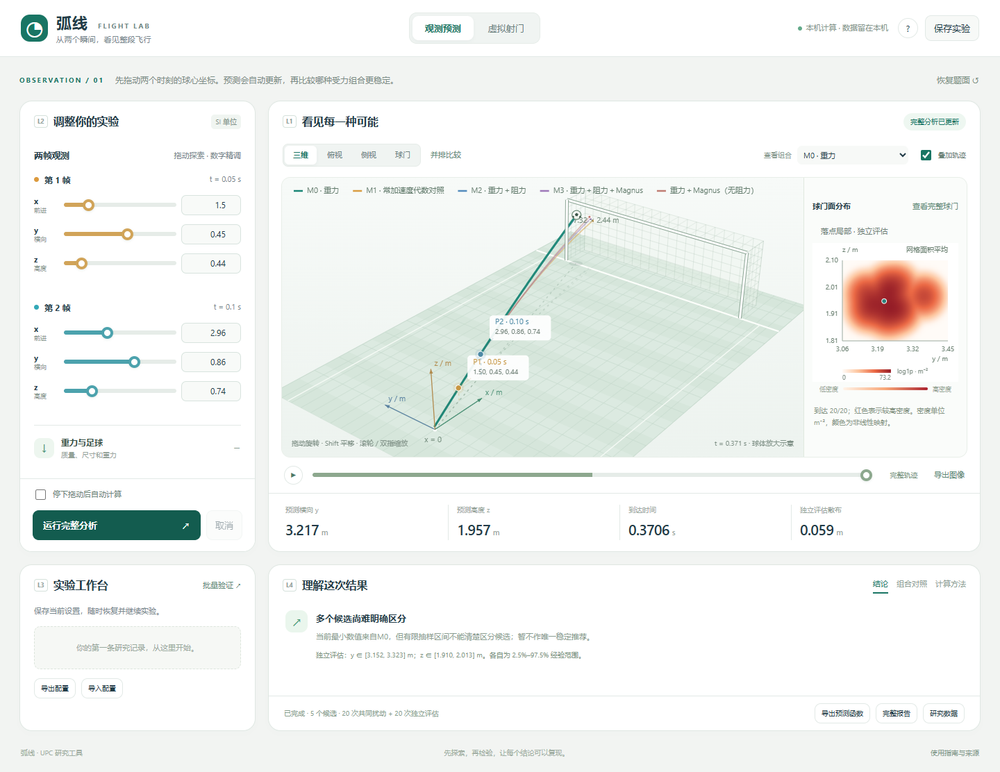

# 弧线实验室使用与实验指南

## 01  弧线实验室使用与实验指南

这套软件从两个时刻的球的位置出发，比较受力方案，观察预测落点怎样随输入误差而变化，再用虚拟射门检查预测是否偏离参考答案。先按下面路线做一次操作，不需要先读懂所有公式。

> 滑条是在改输入；热图是在展示预测点云；最终采用哪个方案，还要看误差、覆盖和失败情况，不能只看哪张图最红或最窄。

### 五分钟完成第一次操作

1. 完整解压离线包，用Edge或Chrome打开index.html，点击“恢复题面”，停留在“观测预测”。当前在线链接为创建者账户私有；队友可直接用离线包。

2. 取消自动计算，展开“观测误差与精度”，选“快速探索 · 20 + 20”。点击“运行完整分析”。

3. 等右上出现“完整分析已更新”。先读预测横向y、预测高度z、到达时间，再看独立评估散布。

4. 用“查看组合”切换显示；点“组合对照”，检查残差、到达/总数和边界命中。

5. 把第2帧y从0.86改成0.87，再运行，观察变化。这是灵敏度试验；正式题给案例前应恢复题面。

6. 点“查看完整球门”判断位置，再放大落点看云形。导出“配置”“研究数据”“完整报告”，保存第一份记录。

### 按目的选择阅读位置

| 你想做什么 | 阅读位置 |
| --- | --- |
| 熟悉界面和参数 | 第2-4页 |
| 理解热图和不确定度 | 第5-7页 |
| 安排实验和写论文 | 第8-9页 |
| 保存、复现和排查 | 第10-11页 |

在线入口：https://upc-flight-lab-20261107.corkycake1.chatgpt.site

> 20+20是入门预算，默认标准预算为60+60。增加样本可以降低抽样波动，但不会自动补上缺失物理机制或测量依据。

## 02  界面地图与两种模式



截图使用20+20预算，数字用于认位置，不作为论文结论。

| 区域 | 这里做什么 |
| --- | --- |
| L2 左上 | 调两帧六轴坐标；继续向下滚动，展开重力、阻力、旋转、风和误差组。 |
| L1 右上 | 旋转/缩放三维场景，切换视角、播放轨迹、看热图和并排组合。 |
| L3 左下 | 保存设置、导入/导出配置、启动批量验证。 |
| L4 右下 | 读结论、组合对照、计算方法和状态，导出完整结果。 |

### 两种模式回答不同的问题

观测预测：给软件已知的两帧，问“在这些假设下会到哪里、波动多大”。没有真实终点，不能直接知道真实误差。

虚拟射门：先生成完整模拟参考，再只交给预测方法两个含噪位置，问“是否预测到参考答案”。这能检查方法，但模型生成的参考不能代替实球验证。

## 03  参数怎样调才有意义

| 参数组 | 改变什么 | 解释与单位 |
| --- | --- | --- |
| 两帧坐标 | 第1/2帧x、y、z | 米；x朝球门，y横向，z向上。时刻0.05/0.10秒；滑条探索，数字框精调。 |
| 重力与足球 | 质量、半径、g、初始高度 | 默认0.43 kg、0.11 m、9.80665 m/s²、0.11 m；视为已知条件。 |
| 空气阻力 | 密度与参考Cd | rho单位kg/m³。观测模式Cd由候选反演；虚拟参考Cd控制生成器。 |
| 旋转作用 | 参考by、bz | 有效Magnus参数，s^-1；不是实测转速，不能直接换成rpm。 |
| 风场 | 三方向均匀风 | m/s；给定情景，不从两帧联合推断风与所有其他未知量。 |
| 误差与精度 | sigma、预算、种子 | sigma默认0.01 m即1厘米；是噪声假设，不是滑条步长。 |
| 生成这次射门 | 参考初速与受力 | 虚拟模式可调，真值用于检验，不偷偷给反演答案。 |
| 候选组合 | 阻力、旋转、M1开关 | 控制搜索范围；重力是物理基底，M1另列为代数对照。 |

### 风开关最容易被误解

风滑条控制虚拟参考的风。“比较有风与无风的组合”只决定是否加入给定风候选。取消勾选不等于让参考无风；做无风基准要把三方向风速都设为0。默认风情景为[0,2,0] m/s。

### 一次只改变一个原因

首次探索时固定其他设置，只改一个坐标或参数，记录改前/改后。改变质量、半径等已知条件，是条件敏感性研究；把它们计入概率不确定性，还需给出误差分布和相关性。

> 题目没有给相机噪声、自旋真值或球型。sigma、环境和参数搜索边界要明确标为假设或有来源的已知条件；滑条上下限不是实验置信区间。

当前误差模型：六个坐标采用独立、同方差、加性高斯扰动；初始位置和两帧时刻视为精确。这些是假设，不由题面小数位自动确定。

## 04  按这个顺序读一次结果

### 先看是不是当前结果

调整时先更新观测点和轨迹预览，统计稍后更新。“统计待更新”时热图仍可能属于上一次完成任务；报告和研究数据也导出那份快照。

### 再看候选能否解释输入

检查残差、到达分母和边界命中。例如完整M3用6个参数拟合6个坐标，残差小不能独自证明模型真实；其他候选参数数目不同。

### 然后比较集中程度

合格候选按S=sqrt(trace(Cov(y,z)))比较。S小表示围绕云自身中心更集中，不表示中心离真实落点更近。

### 保留难以区分的候选

出现“多个候选尚难明确区分”时不宜声称唯一最佳。“查看组合”仅切显示，不能把点选对象当成统计推荐。

### 最后看参考误差

虚拟模式给出预测与参考的距离、经验椭圆面积及参考是否在内，用来发现“很集中但预测偏了”。

| 候选 | 机制和用处 |
| --- | --- |
| M0 | 重力解析基线。 |
| M1 | 常加速度代数对照，不是额外物理场。 |
| M2 | 重力+平方阻力；反演常数Cd。 |
| M3 | 重力+阻力+有效旋转作用。 |
| 其他组合 | 例如无阻力的重力+旋转，及给定风情景；重复项去除。 |

> 显示的预测y/z和热图名义点来自原观测拟合后的交点，不保证是热图峰值。名义预测、点云均值、密度众数是不同估计量，论文应明确采用哪个。

## 05  热图究竟表征什么

想象相机坐标有一点误差：每次在同一组观测附近生成可能的坐标，重新拟合并预测。重复后，球门平面上形成一团落点，热图是这团点的平滑密度表示。它不是量子波函数，也不是空气流场。

教学示意图见配套 PDF。本节文字给出相同解释。

教学示意，不是新增实验结果。实际界面采用非线性色标。

### 红色是密度，不是一个点的概率

```text
区域A的条件质量 = 在A内对 f_m(y,z) 做二维积分
密度单位 m^-2；区域概率质量无量纲，位于0到1之间
```

同样大小的小区域内，密度更高通常表示落入其中的比例更大。不能把单个像素数值直接当概率；密度数值大于1也完全可能。

### 这张图以到达球门平面为条件

只用成功穿过x=11 m平面的样本，门框外过平面点仍保留。先触地、拟合失败或超出工作域等情况保留在总尝试分母中，不能因为没画在热图里就忽略。

例如100次尝试90次到达，某区域占到达密度的60%，则全部尝试对应质量为0.90×0.60=0.54。它依赖噪声、模型和算法，不能直接称为现实54%进球率；数值失败也不是实球射门事件。

> 局部放大只是裁图。单图色标自适应，不能跨图只看红色深浅排名。并排比较共用坐标/色标，但展示筛选批；主图优先用独立评估批，请读标签。

## 06  热图怎样变成不确定度

热图可视化分布；不确定度需提取数值并交代口径。可以同时给散布、区域与失败比例，不必压成一个数。

| 量 | 回答的问题 | 不能替代什么 |
| --- | --- | --- |
| 协方差与S | 云沿什么方向伸展，总体多散；S单位m。 | 不等于相对真实位置的RMSE。 |
| y/z/t边际范围 | 每个分量2.5%-97.5%经验范围。 | 两条95%范围不是联合95%区域。 |
| 经验椭圆与面积 | 二维范围和大小；面积m²。 | 尚未校准，也不是KDE最高密度区域。 |
| 模拟覆盖率 | 多次测试中区域是否包含参考。 | 一次在区域内不能证明95%覆盖。 |
| 失败分母 | 多少尝试没有可用点或区域。 | 不能删失败后只报好看的数字。 |

教学示意图见配套 PDF。本节文字给出相同解释。

示意中十字为参考。窄但偏离的云不一定比宽而覆盖参考的云可靠。

### 独立评估没有自动完成校准

冻结筛选后换随机扰动流，可以减轻筛选时偶然小散布带来的乐观判断，但没有增加真实射门，也不能消除模型偏差。

当前主云主要反映观测误差传播。受力方案变化导致云中心分离，是模型差异；积分加密导致变化，是数值误差。软件没有自动把它们合成总密度，也没有给模型真实性分配概率。

> 建议先检验误差、覆盖和失败是否可接受，再比较区域大小。当前自动推荐仍是通过门限后的最小S；覆盖校准与据此选型需要后续方法工作。

## 07  怎样跑虚拟射门和批量验证

### 先跑一个知道参考的射门

1. 切到“虚拟射门”，从参考受力“重力”开始，三方向风速设为0，保持其他已知条件不变。

2. 设置参考初速，保持sigma为明确假设。运行，勾选“显示模拟参考答案”，比较预测与参考。

3. 再改阻力或旋转参考，检查忽略该机制的候选是否偏移。各候选共用观测，才便于比较。

4. 手动改两帧时参考仍不变，这是人工观测情景；用“重新生成观测”恢复由参考生成的数据。

### 批量有两层次数

左侧20+20、60+60或200+200，是一例观测内部的扰动次数。“批量验证”的重复次数是外层参考案例数。扫描3个取值、各重复10次，得到30例；每例还要运行各候选的内部扰动计算。

先用少量重复检查流程，再确定正式预算。探索后冻结候选、范围、门限和评价标准。先将“本批随机种子”改成所有探索批未用过的新值，例如20261109，再选“冻结方案后的独立种子测试”。仅切换阶段可能重复探索批的观测。看完测试又调规则，就另留新测试批。

### 覆盖分母一起看

```text
80个参考到达；60个有可用区域；54个包含参考
条件覆盖：54/60 = 90%
全参考到达覆盖：54/80 = 67.5%（缺区域计未覆盖）
```

位置RMSE只在预测与参考都到达时计算，应同时报告分母。参考不达、预测不达、区域退化和拟合失败分别记账；批量JSON比界面简表更完整。

> 换种子不等于现实独立数据。参考和预测采用同类内核；批量检验针对声明的模拟条件。覆盖率本身有抽样波动，正式论文还应给误差条。

## 08  可以直接采用的六项实验

以下是设计建议，不是已完成的论文结果。数值范围先声明；先检查流程，再决定正式预算。

| 实验 | 操作与控制变量 | 收集的证据 |
| --- | --- | --- |
| 1 原题与组合 | 恢复题面，固定sigma和环境，枚举候选；M1单列。 | y/z/t、残差、资格理由、散布、到达和边界分母。 |
| 2 观测假设 | sigma=0.005/0.01/0.02 m；另固定sigma，对六坐标逐个正负扰动。 | 预测变化、候选切换、区域大小；区分概率假设与情景扫描。 |
| 3 机制验证 | 分别用重力、阻力和旋转参考，固定其他条件、重复噪声。 | 生成机制×预测方法的误差、覆盖、面积和失败表。 |
| 4 风的遗漏 | 参考风如[0,3,0] m/s，勾选有风/无风候选，共用观测。 | 检查是否集中但偏移；不能仅按S判断准确性。 |
| 5 工况扫描 | 前向速度20/30/40 m/s，或Cd=0.15/0.30/0.45；一次扫一项。 | 按工况分组误差、到达比例和面积；不能当自然总体分布。 |
| 6 冻结后测试 | 固定规则，用独立种子和未据此调参的案例。 | 覆盖及误差条、面积、位置/时间误差与全部分母。 |

### 判断预算是否足够

分别增加内部扰动次数和外部案例数。内部看S、分位范围和候选判断是否稳定；外部看误差、覆盖估计是否稳定。界面三档预算不是积分步长收敛检验。

独立同分布近似下，覆盖比例p的标准误约sqrt(p(1-p)/K)。K取该覆盖指标的外层分母：上一页条件覆盖用60，全部参考到达口径用80；不是内部扰动次数。工况扫描可能异质，应分组解释，不能盲套同一总体区间。

> 解析极限、积分步长、事件定位等数值验证仍单独报告。代码附有验证记录，新工况超出既有检查范围时应增加对应验证。

## 09  怎样基于软件写论文

| 部分 | 应该写什么 | 软件材料 |
| --- | --- | --- |
| 问题与输入 | 两帧、坐标、初始位置、目标平面，原题值不改。 | 题面恢复、配置。 |
| 物理模型 | 受力、相对风速、经验关系、可辨识性。 | 方法、来源、各候选拟合。 |
| 一般方法 | F：两帧→拟合→资格→比较→预测及不确定度。 | 预测函数、候选和评估。 |
| 验证 | 方程是否算对；另说明现实确认程度。 | 解析/独立数值测试、模拟对照。 |
| 题给结果 | 点估计、时间、区域、失败与并列。 | 研究JSON、报告、可重绘数据。 |
| 不确定性与局限 | 噪声依据、覆盖、模型差异与数值误差。 | 敏感性、批量JSON；校准与误差条需后处理。 |

### 方法段可以从这段话改写

“在声明的观测误差和已知物理条件下，对各受力候选作两帧反演；施加共同观测扰动，保留到达与失败记录，经相容性和可用性检查后比较散布。选择冻结后用新扰动流评估条件范围，再用独立设计的模拟参考案例，联合检查点误差、覆盖与区域大小。”

采用前补齐实际候选、门限、预算、种子和噪声依据。支持某项功能不等于已做完该项实验；没有完成的检验应写作计划或局限。

### 正文需要静态证据

建议一张方法流程图、一张候选比较表、一张统一坐标落点图、一张误差/覆盖/面积对照图。轴、单位、样本量和条件完整，图表由同一次结果生成。界面截图说明交互设计，不能替代核心结果图。

> “最可能位置”须定义为名义交点、均值还是KDE众数。当前网页未自动求密度峰；采用众数要另做求峰和敏感性检验。也不能以网页链接替代官方要求的论文附件。

## 10  保存记录与交给队友复现

| 按钮或文件 | 保存什么 | 用途 |
| --- | --- | --- |
| 保存实验 | 当前浏览器设置，最多12条；重开后重算。 | 临时探索。 |
| 导出配置 | 当前编辑状态。 | 跨设备恢复，与结果快照分别归档。 |
| 研究数据 | 上次完成的逐样本、候选、评估和参考。 | 论文后处理、检查分母。 |
| 完整报告 | 完成快照HTML、图形、方法和参数。 | 阅读、打印、审查。 |
| 导出预测函数 | 可输入新两帧重算的算法。 | 复现F，不是只保存一张热图。 |
| 导出图像 | 当前三维PNG。 | 交流示意，需绑定数据和配置。 |
| 导出批量数据 | 全部案例、参考、误差/覆盖和分母。 | 分组、重绘、误差条。 |

### 一组正式实验至少保存什么

一起保存配置、研究/批量JSON、代码版本、条件说明和报告。明确是原题预测、模拟验证还是参数情景。图表不要使用与正文不同的旧结果。

### 可选命令行

```text
node run-lab.cjs study 实验配置.json 观测结果.json
node run-lab.cjs virtual 虚拟配置.json 虚拟结果.json
node run-lab.cjs default-batch 批量配置.json
node run-lab.cjs batch 批量配置.json 批量结果.json
```

在实验室目录执行，需要本机Node.js，网页本身不需要。前两条读网页配置；批量输入从default-batch模板整理，不能直接把批量输出当输入。双轴、自定义预算和噪声误设适合CLI。

> S仓：仿真/网页版/UPC_交互实验室。队友AI先读latex/AI/网页版实验室使用与论文交接.md。MATLAB版单独保留；采纳新数据时成套同步论文，不混用统计口径。

## 11  常见疑问与可用范围

### Cd与旋转滑条为什么灰了

观测模式要反演这些参数；虚拟模式才直接设置参考真值。

### 热图不出现或无合格候选

可能零噪声、点云退化、到达不足、残差大或域外。先看失败原因，不要只为图好看删失败或放宽门限。

### 轨迹变了热图没立刻变

预览与完整统计分开更新。等“完整分析已更新”，或手动运行。

### 为什么触地后不继续

只计算首飞，没有反弹、碰撞或守门员。

### 已得到可信95%区域了吗

尚无自动校准保证。边际范围、经验椭圆、模拟覆盖和现实覆盖分别说明。

### 论文仿真实验都做完了吗

没有。已通过61项科学软件检查和19项浏览器检查，另有小型演示。正式实验仍需团队确定设计、预算和结论。

### 来源与进一步阅读

UPC 2026 B题：university-physics-competition.com/2026-competition。要求一般预测方法、测试和不确定性，没有指定唯一指标。

JCGM 101:2008、102:2011：bipm.org/en/doi/10.59161/jcgm101-2008；bipm.org/en/doi/10.59161/jcgm102-2011。分别涉及蒙特卡洛传播与多输出。

Gneiting、Balabdaoui、Raftery（2007），Probabilistic forecasts, calibration and sharpness，DOI 10.1111/j.1467-9868.2007.00587.x。区分校准和集中度。

实际功能以代码为准；标准、气动力实验适用范围和许可证见sources.json。参考文献并不证明本软件已完成现实物理确认。
