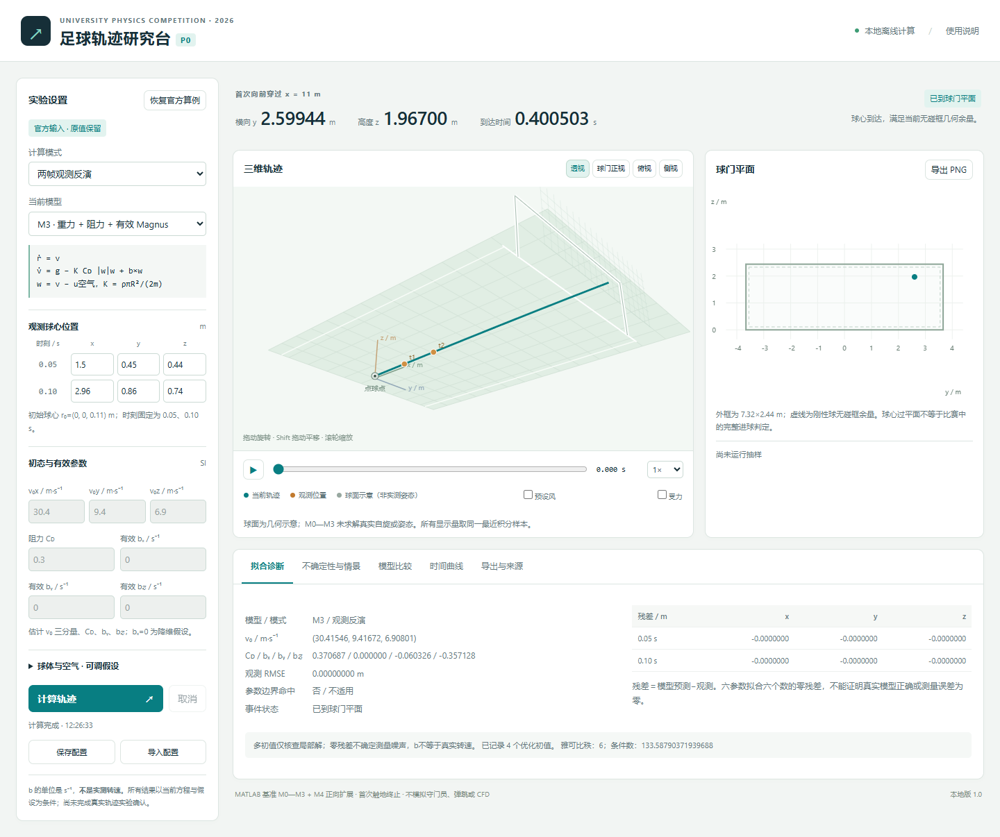

# 足球交互端入口：当前实验室与历史初稿

2026-11-07 更新：队友已将仿真分为 MATLAB 版和网页版。本入口继续保留在原位置，当前版本位于同级 `UPC_交互实验室/`；下方初稿归档和旧 ZIP 保留。

## 先打开当前版本

- [在线实验室](https://upc-flight-lab-20261107.corkycake1.chatgpt.site)：当前为创建者账户私有，队友不一定有访问权限。
- [下载当前完整离线包](../UPC_交互实验室_离线包.zip?raw=true)：完整解压后用 Edge/Chrome 打开 `UPC_交互实验室/index.html`。无需网络、MATLAB、Node.js或账号。
- [当前源码、示例与验证材料](../UPC_交互实验室/)：GitHub 的 HTML 文件页展示源码，不是运行中的网站。
- 人类阅读：[11页图文指南 PDF](../UPC_交互实验室/使用与实验指南.pdf) · [Markdown 版](../UPC_交互实验室/使用与实验指南.md) · [可离线阅读的 HTML](../UPC_交互实验室/使用与实验指南.html)。包含上手、参数、热图、实验清单和论文写作路径。
- 队友 AI 先读：[网页版实验室使用与论文交接](../../../latex/AI/网页版实验室使用与论文交接.md)。包含字段、公式、分母、接口、CLI和待补的实验。

当前版本包含六坐标联动、三维轨迹、多种受力组合、观测噪声传播、虚拟射门和批量验证。原有61项科学检查与19项浏览器检查记录随包提供；本轮交付没有修改计算源码，新增报告和文件清单。软件验收和示例不是论文正式实验。

使用前特别注意：批量实验仅切换“独立测试”阶段可能重复探索批的种子。先将“本批随机种子”改为全部探索批未用过的新值，再运行测试。完整操作见指南第7节。

当前热图主要显示观测误差传播后的条件位置密度；自动比较仍按通过资格门限后的最小散布 S，尚未实现覆盖校准后自动选型。正式论文结果仍按项目进度指定的 MATLAB 数据使用；采纳网站结果时应成套同步方法、数据和图表。

当前离线包大小：3302843 bytes；SHA256：`a0c03cbed8f6d2c9ce20836f2d14dc73fdfc258c4ff3113ac12513fc8c151c28`。逐文件清单在包内 `文件清单.json`。

## 下面是初稿 1.0 的历史记录

以下版本功能、数值和“当时未部署”等状态仅描述历史初稿；不要与当前实验室混用。原 ZIP 和源码保持原样，便于追溯。

## 足球交互研究端 · 初稿 1.0

本目录按用户授权归档到 S 仓，供队友查看、离线使用和继续调整 UI。论文采用的模型、实验与结论尚由团队按研究进度选择。既有批量实验是程序验收与示例。

### 下载和打开

- [下载完整离线包](UPC足球交互端_初稿1.0_离线包.zip?raw=true)
- [中文使用说明](UPC_P0/使用说明.md)
- [网页源码入口](UPC_P0/index.html)：GitHub 展示的是文件源码，不是已部署的交互网站。
- [展开源码、数据与验证材料](UPC_P0/)

下载 ZIP 后完整解压，用 Edge 或 Chrome 打开其中 `UPC_P0/index.html`。网页运行无需网络、账号或 MATLAB；不要在压缩包预览中直接打开。当前未部署 GitHub Pages 等在线服务，也未向比赛提交任何材料。

包内支持 M0—M3 观测反演与模型比较、M4 真实角速度正向情景、轨迹与时间控制、统计和确定性情景、配置重载、JSON/CSV/PNG 及 12 帧联系表导出。未知物理量保留为假设；数值验证不等于现实实验确认。

### 配套说明与链接

1. [将交互端作为论文配套材料](UPC_P0/latex/knowledge/论文配套交互端说明.md)
2. [方程与统计口径](UPC_P0/latex/knowledge/方程与统计口径.md)
3. [实现与验证记录](UPC_P0/latex/knowledge/实现与验证记录.md)
4. [足球规则与规格核验](UPC_P0/latex/knowledge/规则与规格核验.md)
5. [气动力实验来源、模型选择与许可](UPC_P0/latex/knowledge/气动力证据与接入决策.md)
6. [三维外观资源与许可](UPC_P0/latex/knowledge/三维资源与许可.md)
7. [交付验收记录](UPC_P0/data/交付验收.json) · [双浏览器30项验收](UPC_P0/data/验证基准/网页验收.json)
8. [参数来源](UPC_P0/data/资料/参数来源.json) · [软件与许可](UPC_P0/data/资料/软件与许可.json) · [示例配置](UPC_P0/data/示例/)
9. [逐文件SHA256清单](UPC_P0/data/交付文件SHA256.json)

### 界面预览

[M4真实自旋界面](UPC_P0/img/网页真实自旋.png) · [12帧演示联系表](UPC_P0/img/交互端12帧演示.png)

### 版本、历史状态与论文使用

本次原样归档此前交付且验收通过的初稿1.0，完整ZIP与展开目录逐文件一致。包内“未上传／未修改S仓”表述是生成初稿时的历史状态，本次用户授权的S仓归档状态以本入口及仓库提交记录为准；“未在线部署、未向赛事提交、未完成实球实验确认”仍有效。保持原科学数据、源码和校验清单不变，便于核对用户已收到的版本。

网页可以作为队内复现工具及按最终规则获准的补充材料，论文仍须用静态图、方程、方法和结果独立说明核心论证。不要用网页链接替代官方要求的论文附件。AI草稿和完整输入输出披露要求见配套说明。

原仓库 `src/`、`data/派生数据/` 及中英文论文没有被本次归档替换。本目录包内修复了边界协方差门控：150个合成样本的有效区域分母为116，116/116是条件覆盖，116/150约77.33%是全分母“成功产生且覆盖”比例；与旧论文历史覆盖口径不同，后续采纳时应成套同步模型、图表和正文，不能混用。

ZIP大小：2,045,752 bytes；SHA256：`c80ed3c85c0be8741f14caa8d30c9ea601894e1c6634f40a48063d480f8c279e`。
